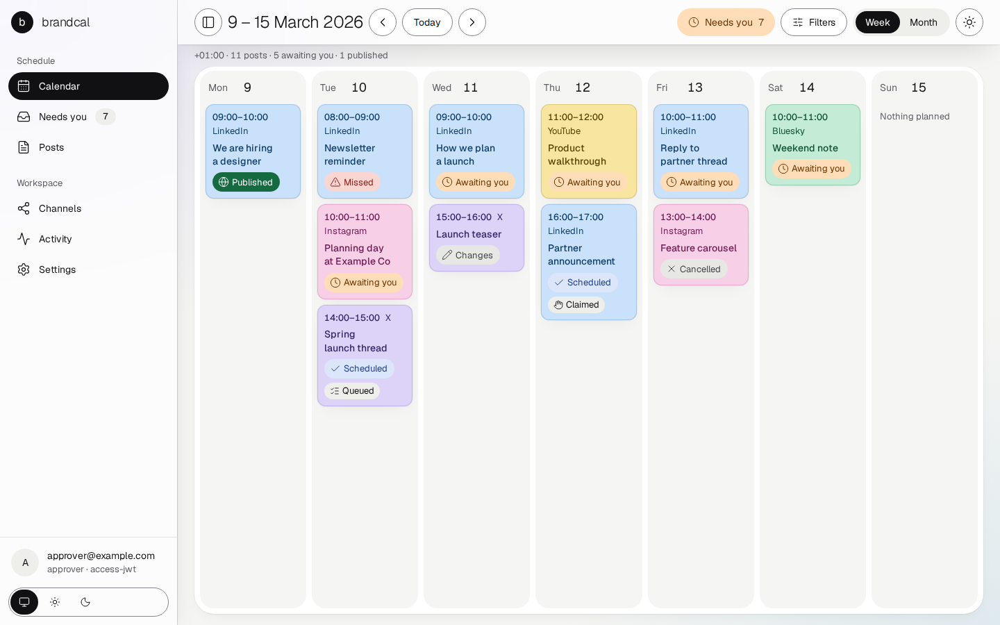
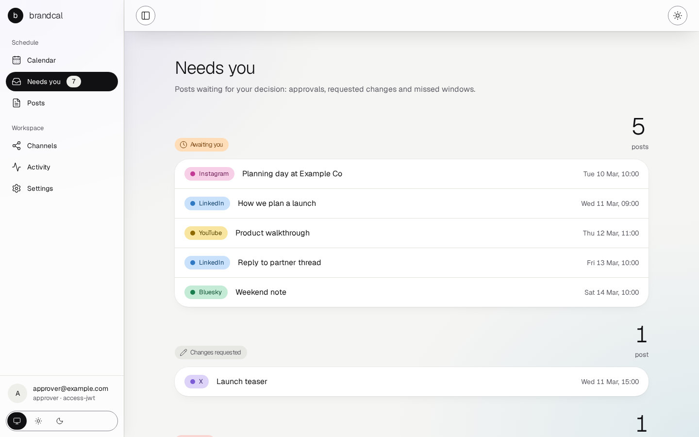
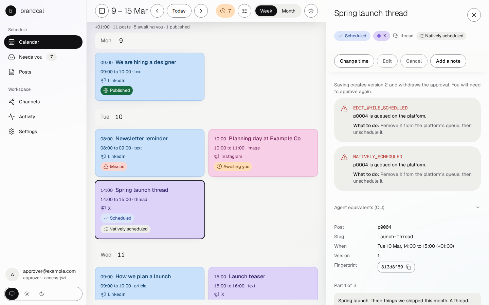
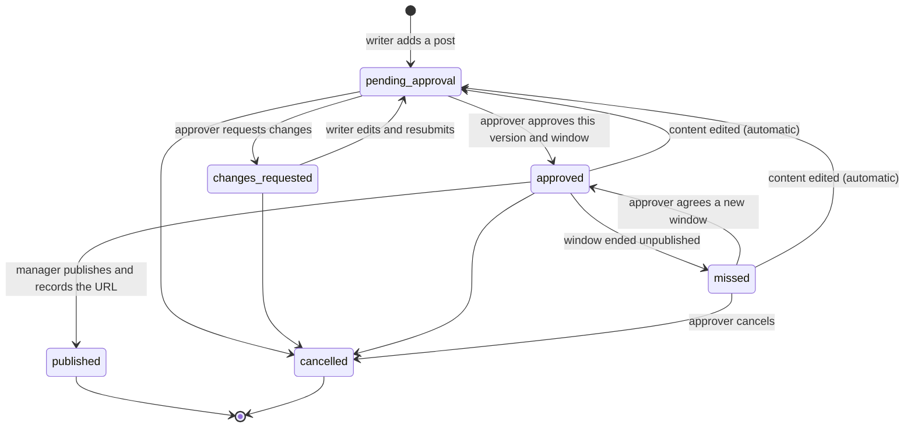

# brandcal

A generic, open-source content calendar for teams and AI agents where **a human approves every
post before it goes out**.

brandcal combines a strict Python CLI, a clean web UI and an append-only, hash-chained audit
log. Agents draft, schedule and publish posts; a human owner reviews and approves each exact
version and time window. It carries no platform credentials, no posting bots and no built-in
brand: you bring your own assistants and publishing workflow.

## Three ways to run brandcal

1. **Self-hosted on Cloudflare (recommended).** Run the web UI and API as a single Cloudflare
   Worker backed by D1, with Cloudflare Access in front and daily JSON snapshots to KV. Nothing
   depends on a single machine staying online, and it fits comfortably inside Cloudflare's free
   tier. Follow [docs/CLOUDFLARE_SETUP.md](docs/CLOUDFLARE_SETUP.md).
2. **Used by an AI assistant in remote mode.** Install the Python CLI for Grok Bot, Claude Code,
   Cursor or any agent with a shell, set `BRANDCAL_REMOTE` and an Access service token, and let
   the assistant read and update the hosted calendar through the full Python core. Follow
   [docs/BOT_INTEGRATION.md](docs/BOT_INTEGRATION.md).
3. **Local CLI with SQLite.** Keep everything in a single `brand.db` file on your own machine,
   with no external services and zero third-party runtime dependencies. Try it below in the quick
   start.

## Web UI

All screenshots below show fake **Example Co** test data.







## Quick start (local SQLite)

Try brandcal locally against the fake data in [examples/](examples/) inside a throwaway
directory. `tests/test_readme.py` runs these exact commands in CI so they stay current.

Install first (Python 3.11 or newer, standard library only at runtime):

```sh
git clone https://github.com/Kaikhalid/brandcal.git
cd brandcal
python3 -m venv .venv && . .venv/bin/activate
pip install -e .
```

Then run the calendar commands:

<!-- quickstart -->
```sh
export BRANDCAL_HOME="$(mktemp -d)"
cp examples/config.json examples/platforms.json "$BRANDCAL_HOME/"
brandcal init --as admin-1
brandcal add --as writer-1 < examples/posts/example-launch.json
brandcal list
brandcal show p0001
brandcal check p0001
brandcal next --as approver-1
brandcal preview p0001 --as manager-1
brandcal audit
brandcal backup --as admin-1
brandcal migrate examples/v1_calendar.example.json --dry-run --as admin-1
```
<!-- /quickstart -->

`preview` returns the version and content hash the approver sees. Once the human approver agrees,
the manager records the decision with that exact version and hash, for example:

```sh
brandcal approve p0001 --version 1 --hash <hash> \
  --channel card --msg msg-001 --words "Approved" --as manager-1
```

When hosted on Cloudflare (or via `brandcal serve`), the human owner can also approve directly in
the web UI once `serve.console_approvals` is explicitly set to `true` in `config.json`. It is
off by default; see [docs/CLOUDFLARE_SETUP.md](docs/CLOUDFLARE_SETUP.md) and
[docs/UI_SPEC.md](docs/UI_SPEC.md).

## Roles and the 6-state model

| Role | Who | Can |
|---|---|---|
| `writer` | AI agent | Add and edit posts, resubmit after requested changes |
| `manager` | AI agent | Relay the approver's decisions, schedule, claim and record publication |
| `approver` | **Human** | Approve, request changes, reschedule or cancel. Only a human approves. |

Every post is in one of six states. `published` and `cancelled` are closed and never reopened.



| State | Meaning |
|---|---|
| `pending_approval` | Near-final post waiting for the human approver |
| `changes_requested` | The approver asked for changes |
| `approved` | The approver approved this exact content (by hash) and time window |
| `missed` | The approved window ended without the post going out |
| `published` | Live, with its URL recorded (closed) |
| `cancelled` | Dropped, with a reason (closed) |

Being queued in a platform's native scheduler (`native_scheduled_at`) or claimed by an agent
(`claimed_by`) are fields on an `approved` post, not separate states.

## Design principles

- **A human approves every post.** Approval is per post, bound to a content hash and a time
  window. Any content edit automatically sends the post back to `pending_approval`; scheduling
  or publishing outside the approved window is refused (`WINDOW_NOT_APPROVED`).
- **Agents never comment.** Comments and replies are refused unless explicitly delegated
  (`COMMENT_NOT_DELEGATED`).
- **Explicit UTC offsets everywhere.** Every time is ISO 8601 with an explicit offset, such as
  `2026-03-02T09:00:00+00:00`. Naive timestamps are rejected (`TIME_OFFSET_REQUIRED`). There is
  no hidden timezone default: configure `"timezone"` in `config.json` or set `BRANDCAL_TZ`.
- **Append-only hash-chained audit.** Every change writes an event on a hash chain verified by
  `brandcal audit` (both locally and on D1).
- **Machine-friendly CLI.** One line of JSON per command, stable error codes and documented exit
  codes ([docs/ERRORS.md](docs/ERRORS.md)).

## Commands

| Command | Purpose |
|---|---|
| `brandcal help [CMD]` | List commands, or show arguments, roles and errors for one command |
| `brandcal schema` | States, transitions, roles and time format as JSON |
| `brandcal init` | Create `brand.db` and seed agents and platforms from `config.json` |
| `brandcal add` / `edit` / `part` / `media add` / `submit` | Draft and revise posts |
| `brandcal note` / `keywords` / `check` | Notes, keywords and platform limit checks |
| `brandcal preview` | Card payload for a manager to show the approver |
| `brandcal approve` / `request-changes` / `reschedule` / `cancel` | Record the human approver's decision |
| `brandcal schedule` / `unschedule` | Record or clear a native platform schedule |
| `brandcal begin` / `published` / `failed` | Claim, publish and close out a post |
| `brandcal list` / `show` / `today` / `tomorrow` / `next` / `events` | Read the calendar and event log |
| `brandcal sweep` / `audit` | Mark missed posts, release expired claims and verify hash chains |
| `brandcal pull --out FILE` | Download a read-only SQLite copy from a hosted Cloudflare calendar |
| `brandcal report weekly` / `render week` | Weekly JSON report and static weekly HTML page |
| `brandcal export` / `backup` / `backup restore-test` / `archive` | Local backups, restore checks and monthly archiving |
| `brandcal migrate FILE [--dry-run] [--legacy-approved]` | Import a v1 JSON calendar |

Every write requires `--as NAME` (or `BRANDCAL_AGENT`).

## Status

brandcal is at **v0.2.0 (Alpha)**.

- **Stable and conformance-tested:** the 6-state workflow, SQLite core, hash-chained audit log,
  Next.js web UI, Cloudflare Worker + D1 backend, daily KV snapshots and CLI remote mode (verified
  by the Python-vs-Worker conformance test suite).
- **Still early:** CLI flags, JSON shapes and error codes may still evolve before v1.0. Media
  storage in Cloudflare mode (R2) is not implemented yet (the cloud media endpoint returns 404).
  The older single-machine tunnel and relay setups (`docs/DEPLOY_UI.md`, `docs/DEPLOY_RELAY.md`)
  are kept for historical reference only.

## Documentation

- [docs/CLOUDFLARE_SETUP.md](docs/CLOUDFLARE_SETUP.md): self-host brandcal on Cloudflare
  (Workers + D1 + Access + KV backups) from zero
- [docs/BOT_INTEGRATION.md](docs/BOT_INTEGRATION.md): connect Grok Bot, Claude Code, Cursor or
  another AI assistant via remote mode (with [`.env.example`](.env.example))
- [D1_MIGRATION.md](D1_MIGRATION.md): Worker + D1 architecture, data mapping and `posts.extras`
  notes
- [docs/SPEC.md](docs/SPEC.md) and [docs/UI_SPEC.md](docs/UI_SPEC.md): full CLI, schema and UI
  specifications
- [docs/ERRORS.md](docs/ERRORS.md): error codes and exit codes
- [CHANGELOG.md](CHANGELOG.md): release history
- [SECURITY.md](SECURITY.md): supported versions and private vulnerability reporting

## Development

```sh
python3 -m venv .venv && . .venv/bin/activate
pip install -e ".[dev,crypto]"
```

Run all checks before committing:

```sh
ruff check .
ruff format --check .
mypy src
pytest
python scripts/privacy_scan.py
```

See [CONTRIBUTING.md](CONTRIBUTING.md) and, for AI agents contributing code,
[AGENTS.md](AGENTS.md).

## Licence

MIT. See [LICENSE](LICENSE).
