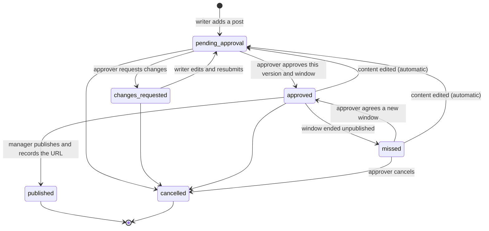

# brandcal

A generic, open-source command-line tool and SQLite library for AI agents that manage a
**human-approved** social media content calendar.

> **Status:** early development (v0.x). Not yet usable. Interfaces, schema and error codes
> will change until v1.0.

## What it is

brandcal keeps a content calendar in a single SQLite file and gives AI agents a small,
strict CLI to work with it. Agents draft, schedule and publish posts; a human approves every
single post before it can go out. Every change is recorded in an append-only, hash-chained
event log, so you can always see who did what and when.

It is deliberately generic: no platform credentials, no posting bots, no built-in brand.
You bring your own agents and your own publishing workflow.

## Roles

| Role | Who | Can |
|---|---|---|
| `writer` | AI agent | Add and edit posts, resubmit after requested changes |
| `manager` | AI agent | Relay the approver's decisions, schedule, claim and record publication |
| `approver` | **Human** | Approve, request changes, reschedule or cancel. Only a human approves. |

## The 6-state model

Every post is in exactly one of six states. `published` and `cancelled` are closed and are
never reopened.



| State | Meaning |
|---|---|
| `pending_approval` | Near-final post waiting for the human approver |
| `changes_requested` | The approver asked for changes |
| `approved` | The approver approved this exact content (by hash) and time window |
| `missed` | The approved window ended without the post going out |
| `published` | Live, with its URL recorded (closed) |
| `cancelled` | Dropped, with a reason (closed) |

Being queued in a platform's native scheduler, or being claimed by an agent for publishing,
are **fields on an approved post**, not separate states.

## Design principles

- **A human approves every post.** Approval is per post, bound to a content hash and to a
  time window. Any content edit sends the post back to `pending_approval`; publishing or
  scheduling outside the approved window is refused (`WINDOW_NOT_APPROVED`).
- **Agents never comment.** Comments and replies are not delegated to agents
  (`COMMENT_NOT_DELEGATED`).
- **Explicit time offsets.** Every time is ISO 8601 with an explicit UTC offset, such as
  `2026-03-02T09:00:00+01:00`. A time without an offset is rejected
  (`TIME_OFFSET_REQUIRED`). The display timezone is configurable; there is no hidden default.
- **Append-only audit.** Every change writes an event; events form a hash chain that
  `brandcal audit` can verify.
- **Safe housekeeping.** Monthly archive of closed posts and verified backups
  (`NO_FRESH_BACKUP` blocks the archive if there is no checked backup).
- **Machine-friendly.** One-line JSON output and stable error codes with documented exit codes.

## Planned commands

| Command | Purpose |
|---|---|
| `brandcal help [CMD]` | List commands, or describe one |
| `brandcal schema` | States, transitions, roles and time format as JSON |
| `brandcal add` / `edit` / `submit` | Write and revise posts |
| `brandcal approve` / `request-changes` / `reschedule` | Record the human approver's decision |
| `brandcal list` / `show` / `today` / `next` | Read the calendar |
| `brandcal schedule` / `unschedule` | Record a native platform schedule |
| `brandcal begin` / `published` / `failed` | Claim, publish and close out a post |
| `brandcal cancel` | Cancel an open post with a reason |
| `brandcal sweep` | Mark missed posts, release expired claims |
| `brandcal audit` | Verify the event hash chain |
| `brandcal backup` / `export` / `archive run` | Verified backups, exports and monthly archive |

Only `--version` and `help` exist today.

## Install and development

Requires Python 3.11 or newer. brandcal uses only the standard library at runtime
(including `sqlite3`).

```sh
git clone https://github.com/Kaikhalid/brandcal.git
cd brandcal
git switch work
python -m venv .venv && . .venv/bin/activate
pip install -e ".[dev]"

brandcal --version
brandcal help
```

Checks (run all of them before committing):

```sh
ruff check .
ruff format --check .
mypy src
pytest
python scripts/privacy_scan.py
```

See [CONTRIBUTING.md](CONTRIBUTING.md) and, for AI agents, [AGENTS.md](AGENTS.md).
The generic specification will live in [docs/SPEC.md](docs/SPEC.md). Example data is in
[examples/](examples/).

## Licence

MIT. See [LICENSE](LICENSE).
