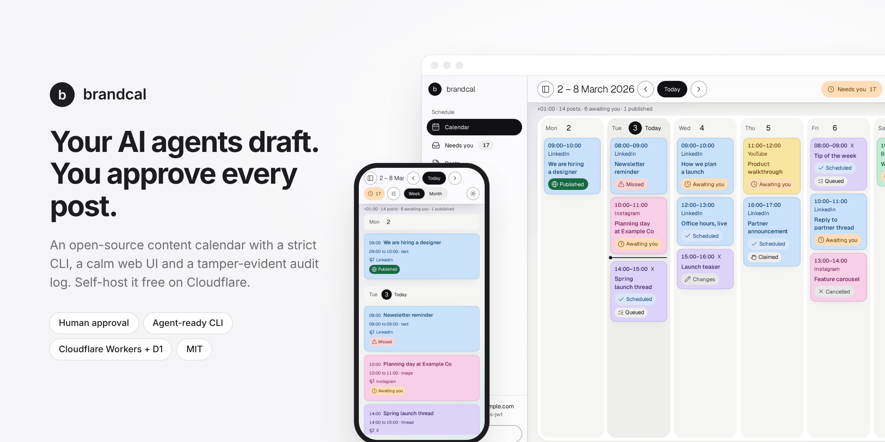
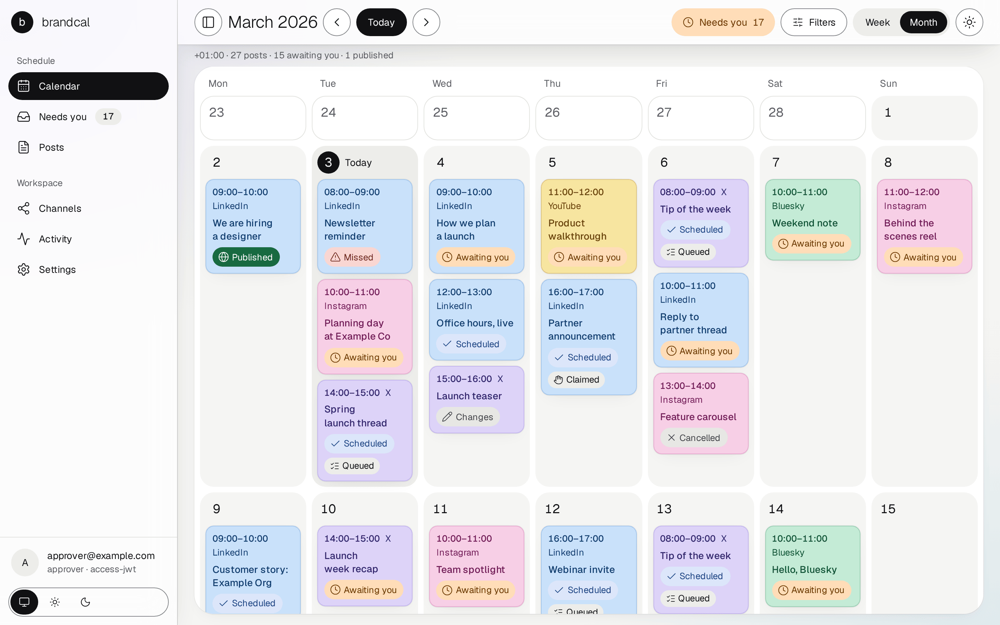
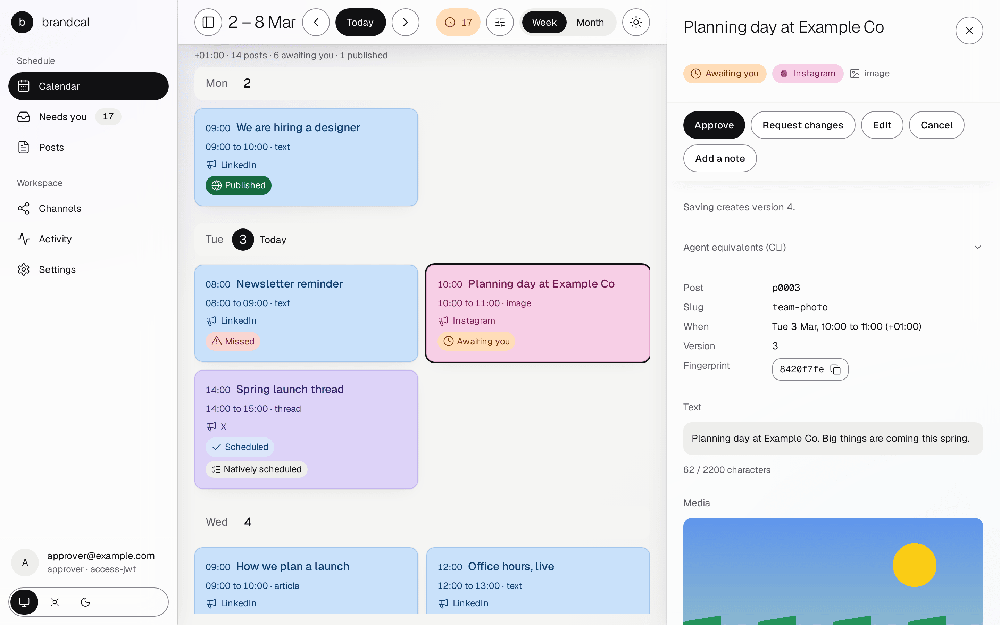
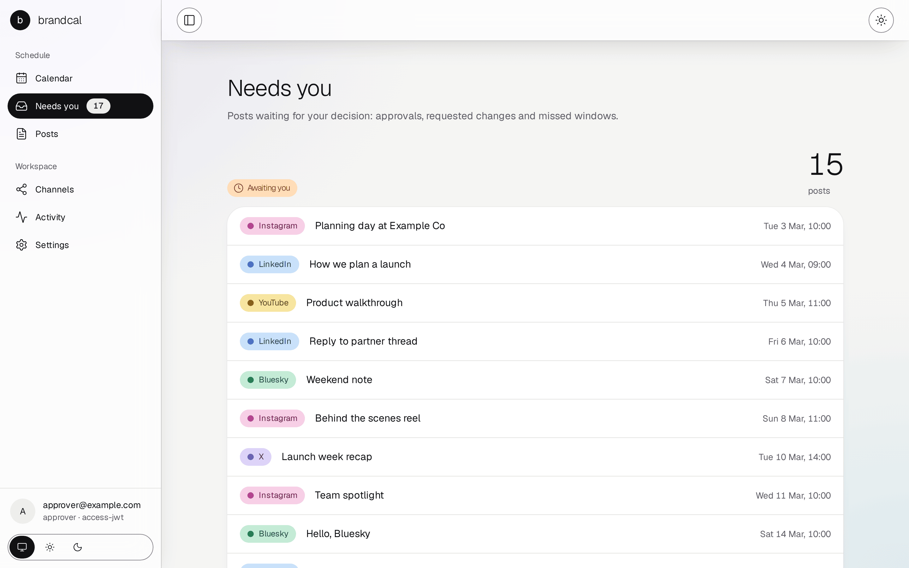
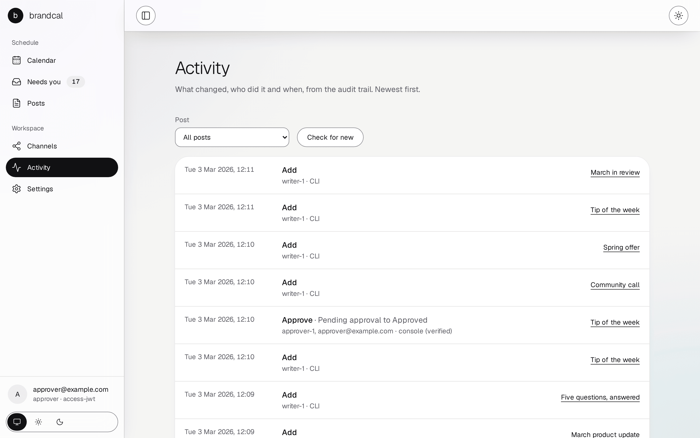
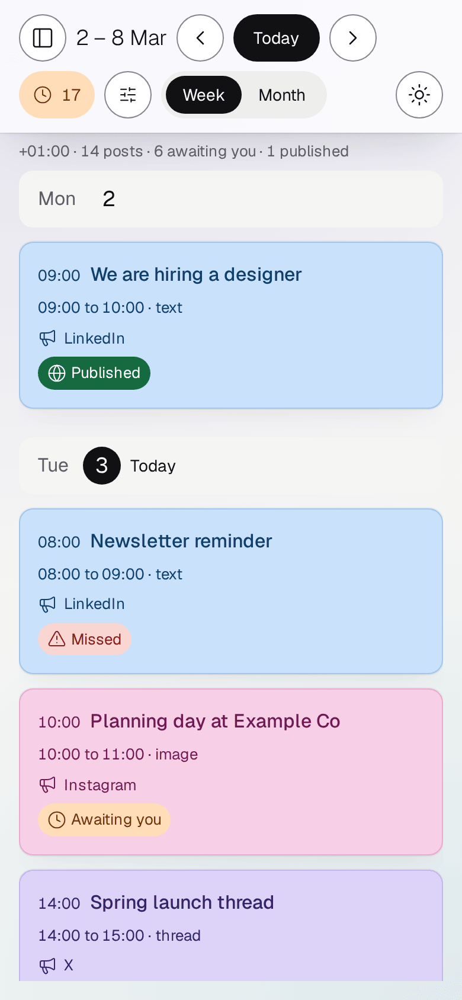
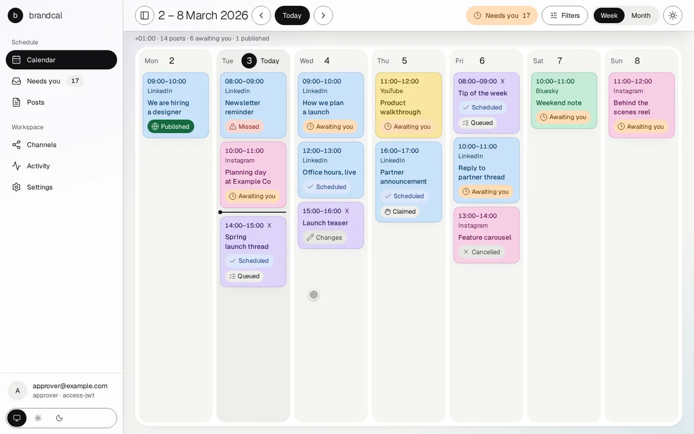
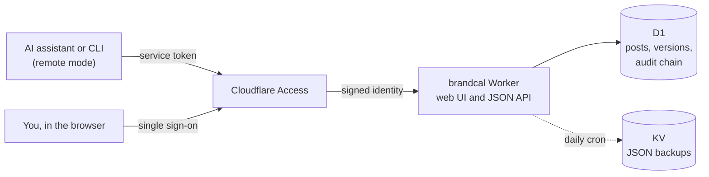
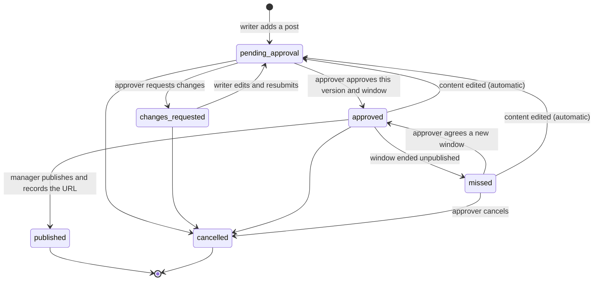

<p align="center">
<picture>
  <source media="(prefers-color-scheme: dark)" srcset="docs/img/hero-dark.png">
  
</picture>
</p>

<p align="center">
  <a href="https://github.com/Kaikhalid/brandcal/actions/workflows/ci.yml"></a>
  <a href="LICENSE"></a>
  <a href="https://github.com/Kaikhalid/brandcal/releases"></a>
  
  <a href="docs/CLOUDFLARE_SETUP.md"></a>
</p>

<p align="center">
  <a href="#quick-start"><b>Quick start</b></a> ·
  <a href="docs/CLOUDFLARE_SETUP.md"><b>Self-host on Cloudflare</b></a> ·
  <a href="docs/BOT_INTEGRATION.md"><b>Connect your AI assistant</b></a> ·
  <a href="#documentation"><b>Docs</b></a>
</p>

**brandcal** is an open-source content calendar for teams that let AI agents do the busywork.
Your assistants draft, schedule and publish posts through a strict, machine-friendly CLI; you
review each one in a calm web UI and approve the exact words and the exact time window. Every
change lands in a hash-chained audit log, any edit after approval sends the post back to you,
and the whole thing runs on Cloudflare's free tier. No platform passwords, no posting bots, no
built-in brand: bring your own assistants and your own publishing workflow.

<sub>Every screenshot shows invented <b>Example Co</b> data.</sub>

## Features

<table>
  <tr>
    <td width="50%" valign="top">
      <h3>A calendar you can read at a glance</h3>
      <p>Week and month views across LinkedIn, Instagram, X, YouTube and Bluesky, with each post's state on its card.</p>
      <a href="docs/img/calendar-month-light.png"><picture><source media="(prefers-color-scheme: dark)" srcset="docs/img/calendar-month-dark.png"></picture></a>
    </td>
    <td width="50%" valign="top">
      <h3>Approve the exact version</h3>
      <p>Each approval is bound to a content fingerprint and a time window. Edit the text and it comes back to you.</p>
      <a href="docs/img/post-panel-light.png"><picture><source media="(prefers-color-scheme: dark)" srcset="docs/img/post-panel-dark.png"></picture></a>
    </td>
  </tr>
  <tr>
    <td width="50%" valign="top">
      <h3>One queue for your decisions</h3>
      <p>Needs you collects posts awaiting approval, posts with requested changes and missed windows.</p>
      <a href="docs/img/needs-you-light.png"><picture><source media="(prefers-color-scheme: dark)" srcset="docs/img/needs-you-dark.png"></picture></a>
    </td>
    <td width="50%" valign="top">
      <h3>An audit trail you can verify</h3>
      <p>Who changed what, when and through which channel, on an append-only hash chain that <code>brandcal audit</code> checks.</p>
      <a href="docs/img/activity-light.png"><picture><source media="(prefers-color-scheme: dark)" srcset="docs/img/activity-dark.png"></picture></a>
    </td>
  </tr>
  <tr>
    <td width="50%" valign="top">
      <h3>Built for agents</h3>
      <p>One line of JSON per command, stable error codes with a suggested next step, and a role for every agent.</p>
<pre lang="sh">$ brandcal next --as approver-1
{"ok": true, "items": [{"id": "p0003",
  "status": "pending_approval",
  "title": "Planning day at Example Co",
  "window": "2026-03-03T10:00:00+01:00/...",
  "next": "brandcal preview p0003"}, ...]}</pre>
    </td>
    <td width="50%" valign="top">
      <h3>Comfortable on a phone</h3>
      <p>Approve from anywhere. Light and dark themes, keyboard friendly, and checked against WCAG 2.2 AA in CI.</p>
      <p align="center"><a href="docs/img/mobile-week-light.png"><picture><source media="(prefers-color-scheme: dark)" srcset="docs/img/mobile-week-dark.png"></picture></a></p>
    </td>
  </tr>
</table>

### Approving a post, start to finish

<p align="center">
  
</p>

## How it works



- **Cloudflare Access** checks every request: you sign in as yourself, bots use a service token.
- **One Worker** serves the static web UI and the API, and verifies the Access identity itself.
- **D1** holds the calendar, and a daily cron writes a JSON snapshot to **KV**.
- The **CLI in remote mode** runs the full Python core on a fresh snapshot and pushes verified
  changes back, so the rules are identical locally and in the cloud (a conformance suite checks it).

Prefer one file on your own machine? The same CLI works locally against SQLite with zero
third-party runtime dependencies.

## Use it with your AI assistant

brandcal works with Grok Bot, Claude Code, Cursor or any agent that can run a shell command.
Install the CLI, give it three environment variables and paste the ready-made instructions from
[docs/BOT_INTEGRATION.md](docs/BOT_INTEGRATION.md).

```sh
pip install "git+https://github.com/Kaikhalid/brandcal.git@v0.2.0"
export BRANDCAL_REMOTE=https://brandcal.example.com
export BRANDCAL_ACCESS_CLIENT_ID=00000000-0000-0000-0000-000000000000.access
export BRANDCAL_ACCESS_CLIENT_SECRET=...   # from your secret store, never the command line
brandcal sweep --as manager-1 && brandcal today
```

Then just ask: *"What is due today?"*, *"Draft a LinkedIn post for Thursday morning"* or
*"Mark p0001 published with its URL"*. The assistant drafts and records; only you approve.

## Quick start

### Local, in two minutes

Python 3.11 or newer, standard library only at runtime. This uses the fake data in
[examples/](examples/), and `tests/test_readme.py` runs these exact commands in CI.

```sh
git clone https://github.com/Kaikhalid/brandcal.git
cd brandcal
python3 -m venv .venv && . .venv/bin/activate
pip install -e .
```

<!-- quickstart -->
```sh
export BRANDCAL_HOME="$(mktemp -d)"
cp examples/config.json examples/platforms.json "$BRANDCAL_HOME/"
brandcal init --as admin-1
brandcal add --as writer-1 < examples/posts/example-launch.json
brandcal list
brandcal show p0001
brandcal check p0001
brandcal next --as approver-1
brandcal preview p0001 --as manager-1
brandcal audit
brandcal backup --as admin-1
brandcal migrate examples/v1_calendar.example.json --dry-run --as admin-1
```
<!-- /quickstart -->

`preview` returns the version and content hash the approver sees. Once the human approver agrees,
the manager records the decision with that exact version and hash:

```sh
brandcal approve p0001 --version 1 --hash <hash> \
  --channel card --msg msg-001 --words "Approved" --as manager-1
```

To see the web UI locally, run `brandcal serve` (see [docs/UI_SPEC.md](docs/UI_SPEC.md)).
Approving in the web UI is off until you set `serve.console_approvals` to `true`.

### On Cloudflare

Deploy the Worker, create D1 and KV, put Cloudflare Access in front and connect the CLI. The
step-by-step guide starts from a fresh account: [docs/CLOUDFLARE_SETUP.md](docs/CLOUDFLARE_SETUP.md).

```sh
npx --prefix cloud wrangler deploy --config cloud/wrangler.local.jsonc
```

## The workflow

| Role | Who | Can |
|---|---|---|
| `writer` | AI agent | Add and edit posts, resubmit after requested changes |
| `manager` | AI agent | Relay the approver's decisions, schedule, claim and record publication |
| `approver` | **Human** | Approve, request changes, reschedule or cancel. Only a human approves. |

Every post is in one of six states: `pending_approval`, `changes_requested`, `approved`,
`missed`, `published` and `cancelled`. The last two are closed and never reopened.

<details>
<summary><b>State diagram</b></summary>



</details>

<details>
<summary><b>All commands</b></summary>

| Command | Purpose |
|---|---|
| `brandcal help [CMD]` | List commands, or show arguments, roles and errors for one command |
| `brandcal schema` | States, transitions, roles and time format as JSON |
| `brandcal init` | Create `brand.db` and seed agents and platforms from `config.json` |
| `brandcal add` / `edit` / `part` / `media add` / `submit` | Draft and revise posts |
| `brandcal note` / `keywords` / `check` | Notes, keywords and platform limit checks |
| `brandcal preview` | Card payload for a manager to show the approver |
| `brandcal approve` / `request-changes` / `reschedule` / `cancel` | Record the human approver's decision |
| `brandcal schedule` / `unschedule` | Record or clear a native platform schedule |
| `brandcal begin` / `published` / `failed` | Claim, publish and close out a post |
| `brandcal list` / `show` / `today` / `tomorrow` / `next` / `events` | Read the calendar and event log |
| `brandcal sweep` / `audit` | Mark missed posts, release expired claims and verify hash chains |
| `brandcal pull --out FILE` | Download a read-only SQLite copy from a hosted Cloudflare calendar |
| `brandcal report weekly` / `render week` | Weekly JSON report and static weekly HTML page |
| `brandcal export` / `backup` / `backup restore-test` / `archive` | Local backups, restore checks and monthly archiving |
| `brandcal migrate FILE [--dry-run] [--legacy-approved]` | Import a v1 JSON calendar |

Every write requires `--as NAME` (or `BRANDCAL_AGENT`).

</details>

### Design principles

- **A human approves every post**, bound to a content hash and a time window. Scheduling or
  publishing outside it is refused (`WINDOW_NOT_APPROVED`).
- **Agents never comment** unless a human delegated that exact comment (`COMMENT_NOT_DELEGATED`).
- **Explicit UTC offsets everywhere.** Naive timestamps are rejected (`TIME_OFFSET_REQUIRED`),
  and there is no hidden timezone default.
- **Append-only, hash-chained audit**, verified by `brandcal audit` locally and on D1.
- **Machine-friendly CLI** with documented error and exit codes ([docs/ERRORS.md](docs/ERRORS.md)).

## Documentation

| Guide | What it covers |
|---|---|
| [CLOUDFLARE_SETUP.md](docs/CLOUDFLARE_SETUP.md) | Self-host on Workers, D1, Access and KV backups, from zero |
| [BOT_INTEGRATION.md](docs/BOT_INTEGRATION.md) | Connect an AI assistant in remote mode, with [`.env.example`](.env.example) |
| [D1_MIGRATION.md](D1_MIGRATION.md) | Worker and D1 architecture, data mapping and `posts.extras` |
| [SPEC.md](docs/SPEC.md) and [UI_SPEC.md](docs/UI_SPEC.md) | Full CLI, schema and web UI specifications |
| [ERRORS.md](docs/ERRORS.md) | Error codes and exit codes |
| [CHANGELOG.md](CHANGELOG.md) | Release history |
| [SECURITY.md](SECURITY.md) | Supported versions and private vulnerability reporting |

## Status

brandcal is at **v0.2.0 (alpha)**. The six-state workflow, SQLite core, audit chain, web UI,
Cloudflare Worker and D1 backend, KV backups and CLI remote mode are stable and
conformance-tested. CLI flags, JSON shapes and error codes may still change before v1.0, and
media storage in Cloudflare mode (R2) is not implemented yet. The older tunnel and relay setups
([DEPLOY_UI.md](docs/DEPLOY_UI.md), [DEPLOY_RELAY.md](docs/DEPLOY_RELAY.md)) are kept for
historical reference only.

## Contributing

Issues and pull requests are welcome. Please open an issue first, branch from `ui` and read
[CONTRIBUTING.md](CONTRIBUTING.md) (and [AGENTS.md](AGENTS.md) if you are an AI agent). Before
committing:

```sh
pip install -e ".[dev,crypto]"
ruff check . && ruff format --check . && mypy src && pytest && python scripts/privacy_scan.py
```

The README images are rebuilt from fake data with `scripts/readme_shots.py` and
`scripts/readme_hero.py`.

## Licence

MIT. See [LICENSE](LICENSE).
