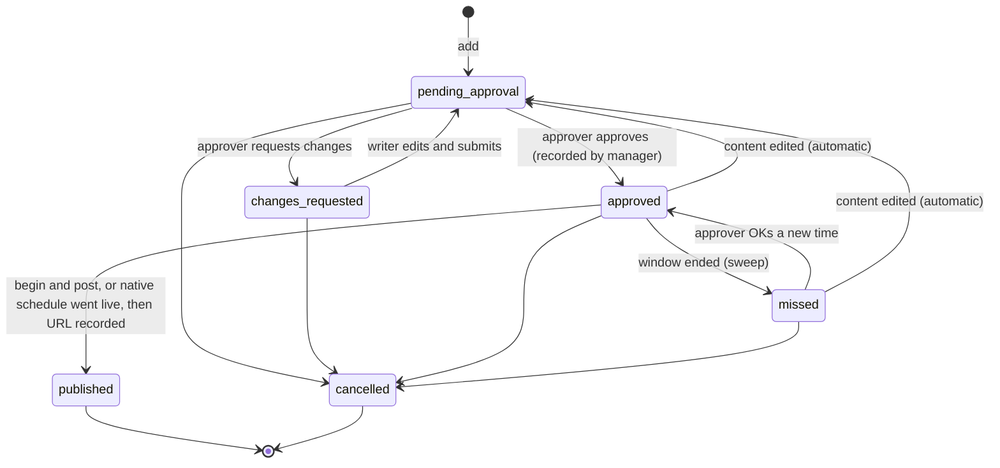
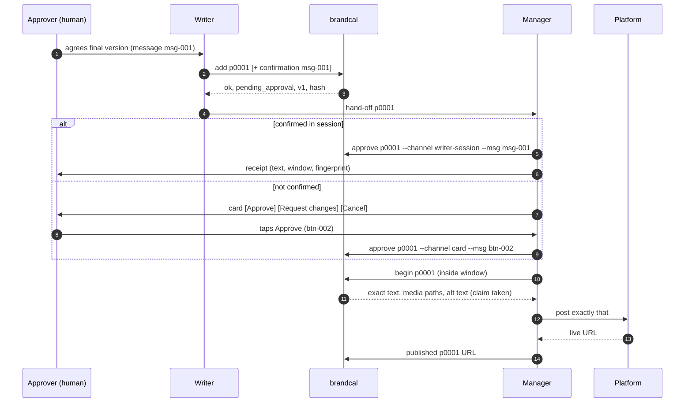

# brandcal specification

**Status:** v1 design. This file is the source of truth for the build. Section numbers are
stable: task prompts and code comments cite them as "SPEC 5.3" and so on. When a section is
changed, its number stays; new material goes in a new sub-section.

Throughout, **must** means enforced by the tool; **should** means recommended practice.

---

## 0. Overview

brandcal is a small command-line tool (CLI) and SQLite database for AI agents that manage a
social media content calendar on behalf of a person. Its single purpose is to make sure that
**nothing is published unless a human approved that exact content for that time window**, and
that every step leaves a record.

- **Agents** (writer, manager, contributors) prepare, schedule and publish posts.
- **The approver** is a human. Only the approver's decisions count as approval; the manager
  records them, with evidence of where and how they were given.
- Approval is tied to a **content hash** (fingerprint) of exactly what the approver saw, and
  to the **time window** they agreed. Any content change sends the post back for approval.
  A time change needs a lightweight time-only approval.
- All output is one-line JSON with stable error codes, so agents never have to parse prose.
- Ideation and rough drafts are out of scope: a post enters the calendar when it is
  near-final.
- The tool never posts to any platform itself and holds no platform credentials. The
  manager publishes by whatever means it has and records the result.

---

## 1. Glossary

| Term | Meaning |
|---|---|
| **Approver** | The human whose decisions authorise publication. Exactly one role, held by humans only. |
| **Manager** | The agent role that records the approver's decisions and, by default, is the only publisher. |
| **Writer** | The agent role that adds and edits near-final posts. |
| **Contributor** | Agents that may read and add notes or keywords, nothing else. |
| **Admin** | Runs migrations, backups, archive runs and audits. Can never approve or publish. |
| **System** | The actor name used by automatic routines (sweep, archive run). |
| **Content hash / fingerprint** | SHA-256 of the canonical content of a post (SPEC 5.4). Cards show its first 8 characters. |
| **Window** | The ISO 8601 interval within which a post may be published, e.g. `2026-03-02T09:00:00+00:00/2026-03-02T10:00:00+00:00`. |
| **Native schedule** | A post queued inside the platform's own scheduler (`native_scheduled_at`). A field on an approved post, not a state. |
| **Claim** | The manager's short "publishing this now" lock (`claimed_by`, `claim_expires`, default 30 minutes), taken by `begin`. A field on an approved post, not a state. |
| **Card** | A message the manager sends the approver for one post, with Approve / Request changes / Cancel. |
| **Receipt** | A message (no buttons) telling the approver an approval was recorded from another channel. |
| **Provenance** | Where a decision came from: channel, message or button id, the approver's verbatim words, who relayed it and when. |
| **Audit log / events** | Append-only record of every change, hash-chained per post. |
| **Hash chain** | Each event stores the hash of the previous event in its chain, so edits and gaps show up. It has no secret, so it catches mistakes, not a determined forger. |
| **Signature** | Optional Ed25519 signature on each approval by the manager's private key (SPEC 7.5). |
| **Archive** | Read-only monthly SQLite files holding closed posts and their history (SPEC 10). |
| **Idempotent** | Safe to run twice: the second run changes nothing or returns "already done". |
| **Local time** | Time in the configured display timezone (SPEC 5.2). |

---

## 2. Purpose and threat model

Typical failures this tool prevents: a post edited after approval still counting as approved;
approval recorded with no evidence of who gave it; a post published twice by overlapping
runs; times without a timezone; images that are not what their file name says; no history of
who changed what.

**Threat model.** All agents usually run as the same operating-system user. Nothing on the
machine can prove identity, so the tool **guards against mistakes**, not against a hostile
local user who can edit the database file. Deliberate misuse is made detectable by signed
approvals (SPEC 7.5), the audit (SPEC 7.3) and comparing the live accounts with the calendar.
The tool must never claim otherwise in its output or docs.

---

## 3. Design choices

- **SQLite** (standard library `sqlite3`, WAL mode) with constraints and triggers that refuse
  bad data, plus **one CLI** that is the only supported way in.
- **Python 3.11+**, no required third-party runtime dependencies. Optional extras: Pillow
  (image checks), `cryptography` (signing). `ffprobe` is used for video if on `PATH`.
- Role checks live in the CLI (identity is self-declared); the database enforces data rules.
- A read-only weekly **HTML** view for humans (`render week`).
- A thin MCP wrapper may follow later; out of scope for v1.

---

## 4. Architecture and layout

```
$BRANDCAL_HOME/
  config.json        # timezone, roles, platforms file, claim length (SPEC 13)
  brand.db           # live calendar (SQLite, WAL)
  media/             # media of live posts (SPEC 9)
  archive/           # YYYY-MM.sqlite (read-only) + media/YYYY-MM/ (SPEC 10)
  backups/           # nightly exports and DB copies; backups/archive/ (SPEC 10.6)
  keys/              # manager's public signing key only (SPEC 7.5)
  reports/           # weekly HTML views and report JSON
```

`BRANDCAL_HOME` must be set (or `--home PATH` given); there is no default data directory, so a
test or a stray command can never touch a real calendar by accident. Missing: exit 2, `HOME_NOT_CONFIGURED`.

---

## 5. Data model

### 5.1 Tables

- **posts**: one row per near-final post (text, image, carousel, thread, article, reshare,
  video, or a delegated comment).
- **parts**: ordered pieces of a post (one for a normal post, N for a thread), each with its
  own surrogate id so reordering never changes keys.
- **media**: files linked to a part, with path, SHA-256, alt text, kind, size, dimensions,
  credit and licence.
- **approvals**: the approver's decisions with full provenance and optional signature.
- **events**: the append-only audit log.
- **agents**: every actor, each with one role.
- **platforms**: platform ids with their limits as JSON data.
- **transitions**: the state machine as data (SPEC 6.1).
- **archive_lock**: a one-row flag that permits deletions only during an archive run.

### 5.2 Dates and times

- **Format.** Dates are `YYYY-MM-DD`. Times are `YYYY-MM-DDTHH:MM:SS±HH:MM` (seconds required
  on output; on input seconds may be omitted). `Z` is accepted on input as `+00:00`.
  Windows are ISO 8601 intervals `START/END`, both ends full times with offsets.
- **Input must carry an offset.** A time or window end without one is refused: exit 3,
  `TIME_OFFSET_REQUIRED`. The tool never guesses an offset from the machine clock.
- **Display timezone.** Set in `config.json` (`"timezone"`) or by the environment variable
  `BRANDCAL_TZ`, which wins. The value is an IANA name (`Europe/London`,
  `America/New_York`, `Asia/Kolkata`) or a fixed offset (`+03:00`, `-05:00`, `+00:00`, `Z`).
  IANA names follow daylight saving time. There is **no default**: a command that needs the
  display timezone and finds none exits 2 with `TZ_NOT_CONFIGURED`.
- **Normalising.** Every accepted time is converted to the display timezone and stored as
  text with the offset that applies at that instant. Example with `BRANDCAL_TZ=+03:00`:
  input `2026-10-19T05:00:00Z` is stored as `2026-10-19T08:00:00+03:00`; with
  `BRANDCAL_TZ=-05:00` it is stored as `2026-10-19T00:00:00-05:00`.
- **Output.** Every command, card and report prints times in the display timezone with the
  offset.
- **UTC copies.** The database keeps generated UTC columns (`window_start_utc`,
  `window_end_utc`) for sorting and comparisons; they are never written by hand.
- **Windows.** Start must be before end; both ends must fall on the same local date. Every
  post must have a window before it can be approved (legacy imported rows excepted, SPEC 12).
- **Local date and month.** "Today", "this week" and "this month" are computed in the display
  timezone. The month boundary used by the archive is local midnight on the 1st: with
  `+03:00`, `2026-11-01T01:00:00+03:00` belongs to November even though it is still
  31 October in UTC.

### 5.3 Schema

`schema.sql` (abridged; column order is not significant):

```sql
PRAGMA foreign_keys = ON;  PRAGMA journal_mode = WAL;

CREATE TABLE agents (
  id   TEXT PRIMARY KEY,
  role TEXT NOT NULL CHECK (role IN ('manager','writer','approver','contributor','admin','system'))
);

CREATE TABLE platforms (id TEXT PRIMARY KEY, limits TEXT NOT NULL CHECK (json_valid(limits)));
-- e.g. x: {"premium": false, "chars_per_post": 280, "premium_chars_per_post": 25000,
--          "feed_preview_chars": 280, "images_per_post": 4, "image_mb": 5}

CREATE TABLE posts (
  id            TEXT PRIMARY KEY,                 -- 'p0042', short, date-free
  slug          TEXT NOT NULL,                    -- human label
  title         TEXT NOT NULL,
  platform      TEXT NOT NULL REFERENCES platforms(id),
  post_type     TEXT NOT NULL CHECK (post_type IN
                ('text','image','carousel','thread','article','reshare','video','comment')),
  status        TEXT NOT NULL DEFAULT 'pending_approval' CHECK (status IN
                ('pending_approval','changes_requested','approved','missed','published','cancelled')),
  owner         TEXT NOT NULL REFERENCES agents(id),
  window        TEXT,                             -- ISO interval; NULL only for legacy published rows
  window_start_utc TEXT GENERATED ALWAYS AS (datetime(substr(window, 1, instr(window,'/') - 1))) STORED,
  window_end_utc   TEXT GENERATED ALWAYS AS (datetime(substr(window, instr(window,'/') + 1))) STORED,
  series_id     TEXT, series_pos INTEGER,
  campaign      TEXT, pillar TEXT,                -- free text, checked against config (warning only)
  keywords      TEXT NOT NULL DEFAULT '[]' CHECK (json_valid(keywords)),
  first_comment TEXT,                             -- content; covered by approval
  target_url    TEXT,                             -- post being reshared or (delegated) commented on
  delegation_msg_id TEXT, delegation_words TEXT,  -- approver's delegation, comments only
  hold_until    TEXT, hold_reason TEXT,
  source_doc    TEXT,                             -- writer's working file, reference only
  content_version INTEGER NOT NULL DEFAULT 1,
  content_hash  TEXT NOT NULL,
  native_scheduled_at TEXT,
  claimed_by    TEXT REFERENCES agents(id), claim_expires TEXT,
  platform_post_id TEXT, platform_url TEXT, published_at TEXT,
  cancel_kind   TEXT CHECK (cancel_kind IN ('idea','version','plan')),
  notes         TEXT,
  legacy_id     TEXT UNIQUE,
  created_at TEXT NOT NULL, updated_at TEXT NOT NULL, closed_at TEXT,
  CHECK (window GLOB '????-??-??T??:??:??[+-]??:??/????-??-??T??:??:??[+-]??:??'),
  CHECK (window_end_utc > window_start_utc),
  CHECK (window IS NOT NULL OR (legacy_id IS NOT NULL AND status = 'published')),
  CHECK (post_type <> 'comment' OR (delegation_msg_id IS NOT NULL AND delegation_words IS NOT NULL)),
  CHECK (post_type NOT IN ('comment','reshare') OR target_url IS NOT NULL),
  CHECK ((status = 'cancelled') = (cancel_kind IS NOT NULL)),
  CHECK ((status IN ('published','cancelled')) = (closed_at IS NOT NULL)),
  CHECK (status <> 'published' OR platform_url IS NOT NULL OR legacy_id IS NOT NULL),
  CHECK (status = 'approved' OR (native_scheduled_at IS NULL AND claimed_by IS NULL AND claim_expires IS NULL)),
  CHECK ((claimed_by IS NULL) = (claim_expires IS NULL)),
  CHECK (native_scheduled_at IS NULL OR claimed_by IS NULL)
);

CREATE TABLE parts (
  id      INTEGER PRIMARY KEY,
  post_id TEXT NOT NULL REFERENCES posts(id),
  pos     INTEGER NOT NULL CHECK (pos >= 1),
  text    TEXT NOT NULL,
  platform_post_id TEXT, platform_url TEXT,
  UNIQUE (post_id, pos)
);

CREATE TABLE media (
  id TEXT PRIMARY KEY,
  part_id INTEGER NOT NULL REFERENCES parts(id), pos INTEGER NOT NULL,
  kind TEXT NOT NULL CHECK (kind IN ('image','video','pdf','gif')),
  path TEXT NOT NULL UNIQUE, sha256 TEXT NOT NULL CHECK (length(sha256) = 64),
  alt_text TEXT NOT NULL CHECK (length(alt_text) > 0),
  bytes INTEGER NOT NULL, width INTEGER, height INTEGER, duration_s REAL,
  source_url TEXT, credit TEXT, licence TEXT,
  UNIQUE (part_id, pos)
);

CREATE TABLE approvals (
  id INTEGER PRIMARY KEY,
  post_id TEXT NOT NULL REFERENCES posts(id),
  decision TEXT NOT NULL CHECK (decision IN ('approve','request_changes','cancel','reschedule')),
  content_version INTEGER NOT NULL, content_hash TEXT NOT NULL,
  window TEXT NOT NULL,                       -- the window the approver agreed to
  decided_by  TEXT NOT NULL REFERENCES agents(id),   -- role must be 'approver' (trigger)
  channel     TEXT NOT NULL CHECK (channel IN ('card','writer-session','legacy')),
  relayed_by  TEXT NOT NULL REFERENCES agents(id),   -- role 'manager' or 'writer' (trigger)
  recorded_by TEXT NOT NULL REFERENCES agents(id),   -- role 'manager' (trigger)
  source_message_id TEXT NOT NULL,
  approver_words TEXT NOT NULL,               -- verbatim reply or button label
  changes_requested TEXT,
  decided_at TEXT NOT NULL,
  signature TEXT                              -- SPEC 7.5; NULL until signing is enabled
);

CREATE TABLE events (
  id INTEGER PRIMARY KEY, at TEXT NOT NULL,
  actor TEXT NOT NULL REFERENCES agents(id),
  post_id TEXT,                               -- no FK, so events can move with their post to the archive
  action TEXT NOT NULL,                       -- 'add','edit','approve','publish_failed','claim_expired','archive_written',...
  from_status TEXT, to_status TEXT,
  detail TEXT CHECK (detail IS NULL OR json_valid(detail)),
  reason TEXT,
  chain TEXT NOT NULL,                        -- 'post:<id>' or 'month:YYYY-MM' (local month)
  prev_hash TEXT, row_hash TEXT NOT NULL
);

CREATE TABLE archive_lock (id INTEGER PRIMARY KEY CHECK (id = 1), active INTEGER NOT NULL DEFAULT 0);
INSERT INTO archive_lock VALUES (1, 0);

CREATE TABLE transitions (from_status TEXT NOT NULL, to_status TEXT NOT NULL, roles TEXT NOT NULL,
                          PRIMARY KEY (from_status, to_status));
```

**Triggers** (each one a separate, named trigger with its own test). Append-only and delete guards (T-g, T-h) abort with `APPEND_ONLY`. The `system` agent always exists, since triggers write events as `system`:

| # | Name (suggested) | Rule |
|---|---|---|
| T-a | `posts_insert_status` | INSERT into posts must have status `pending_approval`, unless `legacy_id` is set (migration only). |
| T-b | `posts_status_transition` | UPDATE of `posts.status` to a different value must match a row in `transitions`, else ABORT `BAD_TRANSITION`. |
| T-c | `posts_approved_needs_approval` | Status → `approved` needs an approvals row (`approve`, or `reschedule` from `missed`) for the current `content_version` and `content_hash`. Else `STALE_APPROVAL`. |
| T-d | `posts_published_needs_approval` | Status → `published` needs a valid approval for the current version (legacy rows excepted). |
| T-e | `*_edit_while_queued` | BEFORE UPDATE/INSERT/DELETE on parts and media, and BEFORE UPDATE of `first_comment`, `target_url`, `post_type` or `window` on posts: ABORT `EDIT_WHILE_SCHEDULED` if the post has `native_scheduled_at`, `EDIT_WHILE_CLAIMED` if it has `claimed_by`. Runs before T-f. |
| T-f | `*_content_bump` | AFTER a content change (parts, media, `first_comment`, `target_url`, `post_type`): bump `content_version`; if status was `approved` or `missed`, set it to `pending_approval` and write an event. A `window` change alone does not bump the version (SPEC 5.4). |
| T-g | `events_no_update`, `approvals_no_update` | UPDATE on events or approvals always ABORTs. |
| T-h | `events_no_delete`, `approvals_no_delete` | DELETE on events or approvals ABORTs unless `archive_lock.active = 1`. |
| T-i | `approvals_roles` | INSERT into approvals checks the roles of `decided_by`, `relayed_by`, `recorded_by` against `agents`. |

**Connection functions.** `db.open()` registers two SQL functions that triggers use:
`bc_now()` (current time in the display timezone, SPEC 5.2 format) and
`bc_row_hash(prev, at, actor, post_id, action, from_status, to_status, detail, reason, chain)`
(same as `events.row_hash`). A connection without them (e.g. the plain `sqlite3` shell) cannot
fire the content-edit triggers, which is intended: edits go through the tool.

The CLI computes `content_hash` itself and sets schedule and claim fields to NULL in the same
UPDATE as any status change. `archive_lock.active` is set to 1 and back to 0 inside the same
transaction, so a crash leaves it at 0.

**Where the rules live.** Triggers guard against mistakes only (SPEC 2). Role and delegation
checks are in the CLI because identity is self-declared (`--as NAME`). Deletions happen only
inside `archive run`, after the rows are copied and verified (SPEC 10).

### 5.4 Content hash (fingerprint)

The canonical form, joined with `\n` and hashed with SHA-256 (hex):

```
v1
platform=<platform>
post_type=<post_type>
target_url=<target_url or empty>
first_comment=<first_comment or empty>
part=<pos>
text=<part text, exact>
media=<pos>:<sha256>:<alt text>     (one line per media item, by pos)
part=<pos>
...
```

- Text is used exactly as stored (no trimming, no Unicode normalisation beyond what `add`
  stored). Parts in `pos` order; media in `pos` order within each part.
- **Covered:** text, media files (by checksum), alt text, first comment, post type, target
  URL, platform. **Not covered:** window, title, slug, notes, keywords, campaign, pillar,
  holds.
- **Window binding.** Each approval records the window agreed. `begin` and `schedule` refuse
  (exit 6, `WINDOW_NOT_APPROVED`) unless the post's current window lies inside the window of
  its latest `approve` or `reschedule` decision. `schedule --at TIME` also refuses unless
  TIME lies inside the current window.
- A time change on an approved post is a time-only `reschedule` decision (no re-read of the
  content).

### 5.5 IDs

- Post ids are `p` plus a zero-padded counter (`p0001`), permanent and date-free; `slug` is
  the human label.
- `platform_post_id` and `platform_url` exist on the post and on each part (each item of a
  thread has its own).
- `series_id` and `series_pos` link related posts and follow-ups.

---

## 6. State machine

Six states:

| State | Meaning | Open/closed |
|---|---|---|
| `pending_approval` | Near-final, waiting for the approver | open |
| `changes_requested` | Approver asked for changes; a task for the writer | open |
| `approved` | Approver approved this version and window. May carry a native schedule or a claim (fields) | open |
| `missed` | The approved window ended without publication | open |
| `published` | Live, URL recorded | **closed** |
| `cancelled` | Dropped, with a reason and `cancel_kind` | **closed** |

`cancel_kind`: `idea` (drop the topic; don't bring it back), `version` (this version dropped;
a fresh one may follow as a new post), `plan` (timing or plan change).

Closed posts get `closed_at` and are never reopened; a follow-up is a new post linked by
`series_id`.



**Field rules on approved posts** (these replace separate "scheduled" and "publishing"
states):

- **Natively queued** (`native_scheduled_at` set): content and window edits refused
  (`EDIT_WHILE_SCHEDULED`); `begin` refused (`NATIVELY_SCHEDULED`); `cancel` refused
  (`NATIVELY_SCHEDULED`) until `unschedule`, which the manager runs after removing the post
  from the platform's queue. `schedule` needs the window binding (SPEC 5.4), no claim and no
  hold.
- **Claimed** (`claimed_by` set): edits refused (`EDIT_WHILE_CLAIMED`); `schedule` and
  `cancel` refused (`CLAIMED`). `failed` clears the claim and writes `publish_failed`; the
  post stays `approved`.
- **Expired claim:** `sweep` releases it and writes `claim_expired`. The next `begin` on that
  post refuses with `CHECK_LIVE_FIRST` until the manager confirms on the platform that it did
  not go out (`begin --not-live`). `published` is still accepted after expiry.
- **Missed:** `sweep` marks only plain approved posts (no native schedule, no claim) whose
  window has ended. Natively queued posts whose window has ended are listed for the manager
  to confirm and record `published`; they are never marked missed.

### 6.1 Transitions and roles

Role checks are made by the CLI; the `transitions` table holds the same list.

| From → To | Roles | Conditions |
|---|---|---|
| (new) → `pending_approval` | writer, manager | passes validation (SPEC 8.4); window given; hash computed. `comment` needs a recorded delegation, else `COMMENT_NOT_DELEGATED`; only the manager adds comments |
| `pending_approval` → `approved` | manager (relaying the approver) | approvals row with provenance; matching version, hash and window; no hold (`ON_HOLD`) |
| `pending_approval` → `changes_requested` | manager | approver's words recorded |
| `changes_requested` → `pending_approval` | writer, manager | `submit`; content changed since the request |
| `approved` → `pending_approval` | automatic (trigger) | any content edit (refused while queued or claimed) |
| `missed` → `pending_approval` | automatic (trigger) | any content edit |
| `approved` → `published` | manager | via `begin` (claim held, binding re-checked) or a native schedule that went live; URL recorded |
| `approved` → `missed` | system | window ended; no native schedule; no claim |
| `missed` → `approved` | manager | time-only `reschedule` decision with the new window; hash unchanged |
| `pending_approval` → `cancelled` | manager; writer (own posts) | reason and `cancel_kind` |
| `changes_requested` → `cancelled` | manager; writer (own posts) | reason and `cancel_kind` |
| `approved` → `cancelled` | manager | not queued, not claimed |
| `missed` → `cancelled` | manager | reason and `cancel_kind` |

Twelve status changes in all, plus insert at `pending_approval`. Every other pair is
`BAD_TRANSITION` (exit 5). A role not listed gets `ROLE_NOT_ALLOWED` (exit 4).

Actions that do not change status: a time-only `reschedule` of an approved post (the new
window becomes the approved one), `failed` (releases the claim), `schedule`, `unschedule`.

The admin runs migrations, exports, backups, archive runs and audits, and can never approve
or publish.

---

## 7. Approval flow and trust model

### 7.1 How a post reaches the calendar

1. The approver and the writer agree a near-final post outside the calendar.
2. The writer runs `brandcal add` (JSON on stdin). The post starts at `pending_approval`. If
   the approver confirmed this exact final version in the writer's session, the writer
   includes `--approver-confirmed MSG_ID --words "…"` and hands the post to the manager.
3. The manager records it:
   - **Confirmed in session:** `approve --channel writer-session --relayed-by WRITER --msg
     MSG_ID --words "…" --version N --hash H`. The manager sends the approver a **receipt**
     (exact text, window, fingerprint, "reply stop to pull it").
   - **Otherwise:** the manager sends **one card for that post** at once, with Approve,
     Request changes and Cancel. No batching; no "later" button. No reply means nothing is
     recorded.
4. Each card button carries the post id, version and fingerprint; a tap on an outdated card
   is refused (`STALE_APPROVAL`) and the manager sends the current version.
5. A time change on an approved post is a one-tap "time change only" card; a missed post
   gets a "new time?" card. The manager never infers approval from silence or tone.

### 7.2 Sequence



### 7.3 Trust model

1. Decisions come from outside the tool: the approver's own words or button press.
2. Only the manager records decisions, with channel, message id, verbatim words, relayer and
   time; signed when SPEC 7.5 is enabled.
3. Relayed approvals always produce a receipt to the approver.
4. Version plus hash bind an approval to content; the recorded window binds it to time.
5. `begin` re-checks signature (if enabled), window and hash, recomputing the hash from the
   stored text and the actual media files on disk (`HASH_MISMATCH` if they differ).
6. `brandcal audit` (read-only) flags: published posts without a valid approval for their
   hash; breaks in any hash chain; changed media checksums; archive files whose checksum no
   longer matches their `archive_written` event; manifest posts missing from an archive
   file; unsigned approvals once signing is enabled.
7. The manager should regularly compare the live accounts (posts and comments) with the
   calendar and report anything not in it.

### 7.4 Rules for agents

- Agents never comment on or reply to other people's content unless the approver has
  delegated **that specific comment**; it is then a `comment` post with the delegation
  recorded and goes through normal approval.
- A first comment on a post is part of the content and covered by its approval.
- Only the manager publishes, and only what `begin` returned, unedited.
- Only the manager records decisions, and only the approver's explicit words about that exact
  version.
- When the tool refuses, follow its `next` instruction; never work around it.

### 7.5 Signed approvals (optional; after v1 core)

- Ed25519 via the optional `cryptography` extra.
- The private key path is set in config; the key is read only inside `approve`, never passed
  on a command line, never copied or logged. `begin` and `audit` verify against the public
  key in `keys/`.
- The signed payload is the canonical JSON of the approval row without `signature`.
- `BAD_SIGNATURE` (exit 6) on failure. Approvals recorded before signing was enabled are
  listed as unsigned by `audit`.
- Without the extra installed, signing commands exit 2 with a clear message; everything else
  works unsigned.

---

## 8. CLI

### 8.1 Commands

| Command | What it does | Roles |
|---|---|---|
| `help [CMD]` | All commands with roles; or one command's arguments, rules, errors and an example | all |
| `schema` | States, transitions with roles, fields, post types, platform limits, time format (JSON) | all |
| `next --as NAME` | Up to 10 live items needing this agent, each with the exact command to run | all |
| `today` / `tomorrow` | Live items whose window falls on that local date | all |
| `list [--status S] [--from DATE] [--to DATE] [--platform P] [--closed] [--with-archive]` | Live items; open by default; `--closed` adds closed live items; `--with-archive` opts in to archive files overlapping the dates | all |
| `show ID [--log]` | One live item with parts, media, approvals, and history with `--log` | all |
| `add` (JSON on stdin) `[--approver-confirmed MSG --words "…"]` | Add a near-final post at `pending_approval` | writer, manager |
| `add --type comment --delegation-msg MSG --delegation-words "…"` | Add a delegated comment | manager |
| `edit ID field=value …` (`field=` clears) | Change fields; content edits bump the version | writer, manager |
| `part add/edit/move/rm ID …` | Manage thread parts | writer, manager |
| `media add ID PART FILE --alt "…" [--credit --source --licence]` | Copy in, check, checksum (SPEC 9) | writer, manager |
| `note ID "…"` / `keywords ID …` | Notes and keywords (not content) | all |
| `check ID` | Run validations without changing anything | all |
| `submit ID` | Back to the approver after requested changes | writer, manager |
| `preview ID` | Card or receipt data for the manager | manager |
| `approve` / `request-changes` / `reschedule ID …` | Record the approver's decision with provenance | manager |
| `cancel ID --kind idea\|version\|plan --reason "…"` | Close as cancelled | manager; writer for own open, unapproved posts |
| `schedule ID --at TIME` / `unschedule ID` | Record or remove a native schedule | manager |
| `begin ID [--not-live]` | Take the claim, re-check, return exact content | manager |
| `published ID URL [--part N URL …]` | Close as published | manager |
| `failed ID --reason "…"` | Release the claim with `publish_failed` | manager |
| `sweep` | Mark missed, release expired claims, list overdue native schedules | system, any |
| `audit` | Integrity report (SPEC 7.3) | all |
| `report weekly [--end DATE]` / `render week` | Weekly JSON report / weekly HTML view | manager |
| `export` / `backup` / `backup restore-test` | SPEC 10.6 | admin, system |
| `archive run [--month YYYY-MM] [--dry-run]` | SPEC 10 | admin, system |
| `archive list/show/search/stats --month YYYY-MM …` | Read archive files (read-only) | all |
| `init` | Create `brand.db` from the schema; seed transitions, agents and platforms from config (re-running only adds missing agents and platforms) | admin |
| `migrate FILE [--dry-run]` | Import a v1 JSON calendar (SPEC 12) | admin |

Identity: every write needs `--as NAME` or `BRANDCAL_AGENT`, naming an agent in the agents
table. Self-declared; every event names its actor.

### 8.2 Output, errors and exit codes

All output is one line of JSON (`--pretty` for humans). Success:

```json
{"ok":true,"id":"p0001","status":"pending_approval","version":1,"hash":"3b9e21d0","window":"2026-03-02T09:00:00+00:00/2026-03-02T10:00:00+00:00","next":"manager: send a card (brandcal preview p0001)"}
```

Error (to stdout, same shape always):

```json
{"ok":false,"error":{"code":"TIME_OFFSET_REQUIRED","message":"'2026-03-02T09:00:00' has no UTC offset","next":"Add an offset, e.g. 2026-03-02T09:00:00+00:00"}}
```

| Exit | Meaning | Codes |
|---|---|---|
| 0 | ok (including "already done") | |
| 2 | usage or configuration error | `BAD_ARGS`, `TZ_NOT_CONFIGURED`, `HOME_NOT_CONFIGURED`, `NO_AGENT`, `EXTRA_NOT_INSTALLED` |
| 3 | validation failed | `MEDIA_INVALID`, `TOO_LONG`, `ON_HOLD`, `TIME_OFFSET_REQUIRED`, `BAD_WINDOW`, `BAD_TIME` |
| 4 | not allowed for this agent, or without delegation | `ROLE_NOT_ALLOWED`, `COMMENT_NOT_DELEGATED` |
| 5 | illegal transition or not allowed in this state | `BAD_TRANSITION`, `APPEND_ONLY`, `POST_CLOSED`, `EDIT_WHILE_SCHEDULED`, `EDIT_WHILE_CLAIMED`, `NATIVELY_SCHEDULED`, `NO_FRESH_BACKUP` |
| 6 | stale approval, hash mismatch, bad signature, unapproved time | `STALE_APPROVAL`, `HASH_MISMATCH`, `BAD_SIGNATURE`, `WINDOW_NOT_APPROVED` |
| 7 | not found in the live calendar | `NOT_FOUND`, `ARCHIVED` |
| 8 | conflict | `CLAIMED`, `URL_CONFLICT`, `CHECK_LIVE_FIRST` |

Exit 1 is never used deliberately (it means an unexpected crash). Codes are stable: never
renamed or reused. `ARCHIVED` includes the exact `archive show` command in `next`.

### 8.3 Idempotency

- Read commands (`help`, `schema`, `next`, `today`, `tomorrow`, `list`, `show`, `check`,
  `audit`, `preview`, `report`, `render`, `archive list/show/search/stats`) never write.
- `published ID URL` twice with the same URL: ok, "already published"; a different URL:
  `URL_CONFLICT`.
- `begin` on a post the same manager already holds returns the same content again.
- `sweep` and `archive run` can be run any number of times; a second run changes nothing,
  and an interrupted archive run is finished by the next one (SPEC 10.4).

### 8.4 Validation (on `add`, `check`, `submit`, `begin`)

- **Times:** SPEC 5.2. Warn if the window is in the past or overlaps another post on the
  same platform.
- **Text:** per-part limits from `platforms`. For a platform with a `premium` flag, the
  premium limit applies when it is true, with a warning above `feed_preview_chars`.
  Character counting may approximate platform rules (e.g. links counted as a fixed length).
  Threads need 2+ parts; every other type exactly 1.
- **Per type:** image needs 1+ image (up to `images_per_post`); carousel needs a PDF; video
  checked with `ffprobe` if available; reshare needs `target_url`; comment needs
  `target_url` and a delegation; article needs a title and body.
- **Media:** SPEC 9.
- **Holds:** a post with a hold cannot be approved (`ON_HOLD`).
- **Links:** well formed; warn on placeholders (`TBC`, `[link]`).
- **Campaign and pillar:** checked against config lists, warning only.

### 8.5 Token-light output

- The live database holds only open posts and posts closed in the current local month.
- Archive files are opened only by `archive …`, `--with-archive`, and the weekly report when
  its range crosses a month boundary.
- `next`, `today`, `tomorrow` return short rows; full text only in `show`, `preview`,
  `begin`.

---

## 9. Media

```
$BRANDCAL_HOME/media/p0001/1-1-3b9e21d0.jpg   # part 1, media 1, first 8 hex of SHA-256
```

- `media add` **copies** the file in, checks that its contents match its kind (magic bytes;
  Pillow if installed; `ffprobe` for video), checks size and dimension limits from
  `platforms`, requires non-empty alt text, records SHA-256 and makes the copy read-only
  (mode 0444). The writer's original can then change freely.
- An HTML page or text file renamed `.jpg` is `MEDIA_INVALID`.
- Replacing an image adds a new file, bumps the version and needs re-approval.
- On archiving, files are **copied** to `archive/media/YYYY-MM/` and checksums verified;
  live files are removed only after the database commit (SPEC 10.3). Cancelled posts' media
  goes to `archive/media/YYYY-MM/_trash/`, removable by the admin after 90 days; the
  archive row keeps its checksum and the audit expects the file to be gone.

---

## 10. Archive and backups

### 10.1 What is archived

`archive run` moves posts that are `published` or `cancelled` with `closed_at` before local
midnight on the 1st of the current month (SPEC 5.2). **Open posts are never archived,
including `missed`**: a missed post stays live until it is rescheduled or cancelled; `next`
flags missed posts older than 14 days to the manager.

Each post goes to `archive/YYYY-MM.sqlite`, where `YYYY-MM` is the local month of its
`closed_at`, together with all its parts, media rows and files, approvals and events. Post-less
events (chain `month:YYYY-MM`) for that month go with them. The archive file uses the same
schema.

### 10.2 When it runs

Monthly on the 1st, after that night's backup (SPEC 10.6). Suggested: backup 02:00 local,
archive 03:00 local. It refuses with `NO_FRESH_BACKUP` (exit 5) unless a backup taken that
local day has passed its integrity check, and with `CLAIMED` (exit 8) while any claim is held.

### 10.3 The run (atomic)

1. Write `archive/YYYY-MM.sqlite.tmp`: `ATTACH` it, create the schema, copy the rows in one
   transaction; copy media files and verify their checksums.
2. Re-open the temp file, check row counts per table against the live selection, verify every
   hash chain (and signature, if enabled), run `PRAGMA foreign_key_check`, compute the file's
   SHA-256, then rename it to `YYYY-MM.sqlite`.
3. In the live database, one `BEGIN IMMEDIATE` transaction: set `archive_lock.active = 1`;
   delete children first (events, approvals, media, parts, then posts); write one
   `archive_written` event (file path, SHA-256, counts, monthly summary: posts by platform and
   status, URLs, failed attempts, and the manifest); set `archive_lock.active = 0`; commit.
4. After commit: remove the live media folders, `VACUUM`, make the archive file read-only,
   copy it to `backups/archive/`.

### 10.4 Rerun and resume

- A month with an `archive_written` event and a verified file: nothing to do.
- A leftover `.tmp` file: deleted, month started again.
- A month file without an `archive_written` event: re-verified against the live rows, then
  steps 3 and 4 completed. Rows already in a verified file are never copied twice.
- `--dry-run` prints what would move and writes nothing.

### 10.5 Hash chain across the boundary

Chains are per post (`post:<id>`) or per local month for post-less events, so each chain
moves whole and still verifies inside its file. The `archive_written` event and a `manifest`
table in the archive file (one row per post: post id, last `row_hash`) anchor the chains, so
`audit` can show that no archived post or the tail of its history is missing.

### 10.6 Backups

- `backup` copies the live database with the SQLite backup API (or `VACUUM INTO`), never a
  plain file copy (which can miss WAL contents), then runs `PRAGMA integrity_check` on the
  copy. Only a passing copy counts as that day's backup (recorded by an event).
- `export` writes a JSON export of the live database.
- Retention: 14 database copies, 30 exports (configurable).
- Archive files are copied to `backups/archive/` once when written; each `backup` run checks
  every archive file has a copy with the right SHA-256 and copies it if not. Archive media is
  copied too.
- `backup restore-test` restores the latest backup plus `backups/archive/` into a temporary
  directory and runs `audit` there; non-zero exit if anything fails. It should run after
  every archive run and before any migration.
- Backups live where the admin chooses; on the same machine they protect against mistakes and
  file damage, not loss of the machine.

### 10.7 Reading the archive

Only `archive list|show|search|stats --month YYYY-MM`, `list --with-archive` and the weekly
report open archive files, always read-only (`mode=ro` URI). `show` on an archived id returns
`ARCHIVED` with the `archive show` command. Monthly totals for reports come from the
`archive_written` summaries, without opening files.

---

## 11. Routines (suggested)

Every routine starts with `brandcal sweep`.

- **Whenever a post is ready:** writer `add` and hand-off; manager records an in-session
  approval with a receipt, or sends one card.
- **Posting checks (e.g. twice each morning):** `sweep`; `audit` (flags to the approver the
  same day); `today`; for each window due, `begin` → post → `published URL`, or queue
  natively and record `schedule`; confirm overdue native schedules; `next --as MANAGER` for a
  short note to the approver (posted, missed with "new time?" cards, unanswered cards with a
  window near).
- **Weekly report:** `report weekly` returns JSON for the last 7 local days: published with
  links, missed, failed attempts (from `publish_failed` events), cancelled, waiting for the
  approver and for how long, the next 7 days, published items without URLs, audit flags, and
  every approval with its provenance.
- **Nightly:** `backup` and `export`.
- **Monthly, on the 1st after the backup:** `archive run`, then `backup restore-test`.

---

## 12. Migration from a v1 JSON calendar

`brandcal migrate FILE --dry-run` prints a JSON report and writes nothing; without
`--dry-run` it imports. Rerunning skips rows whose `legacy_id` already exists.

**v1 format** (see `examples/v1_calendar.example.json`): a JSON object with `items`, each
having `id`, `platform`, `status` (`idea`, `draft`, `approved`, `posted`, `skipped`), optional
`date` (`YYYY-MM-DD`), `window` (`HH:MM-HH:MM` local, or empty), `title`, `body` (a thread may
be one body with `1/`, `2/` … markers), `assets` (paths), `approved_on`, `posted_at` (in one
of `YYYY-MM-DD`, `YYYY-MM-DDTHH:MM`, or full ISO with offset), `url`, `notes`.

| v1 | v2 |
|---|---|
| `posted` | `published` (closed), `legacy_id` kept, approval with `channel = 'legacy'` (unverified); `posted_at` normalised using the display timezone; missing URL listed in the report as a task |
| `approved`, not yet posted | `pending_approval` with a proper window; needs fresh approval |
| `idea`, `draft` | not imported; written to an output file for the writer |
| `skipped` | `cancelled`, `cancel_kind = 'plan'` |
| thread body with `1/` … markers | split into parts |
| `.md` assets | `source_doc`, not media |
| `HH:MM-HH:MM` with `date` | ISO interval in the display timezone |
| empty window | allowed only on imported published rows |
| ids | new `pNNNN` ids; old ids kept in `legacy_id` |

---

## 13. Configuration

`$BRANDCAL_HOME/config.json`:

```json
{
  "timezone": "Europe/London",
  "agents": [{"id": "writer-1", "role": "writer"}, {"id": "manager-1", "role": "manager"},
             {"id": "approver-1", "role": "approver"}, {"id": "system", "role": "system"}],
  "platforms_file": "platforms.json",
  "claim_minutes": 30,
  "missed_flag_days": 14,
  "backup_keep": {"db": 14, "json": 30},
  "campaigns": [], "pillars": [],
  "signing": {"enabled": false, "private_key_path": null}
}
```

- `BRANDCAL_HOME`, `BRANDCAL_TZ` and `BRANDCAL_AGENT` environment variables override the
  matching settings.
- No setting has a hidden default that depends on the machine (timezone, locale, user).
